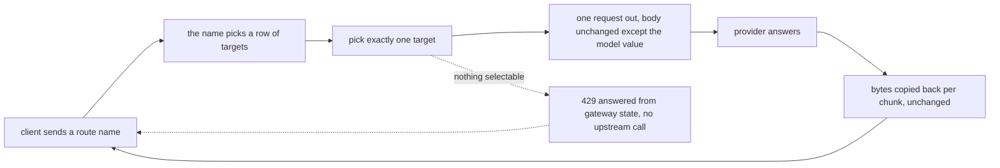

# PlainRoute

<!-- SPDX-License-Identifier: AGPL-3.0-only -->

> **A small, boring, transparent LLM gateway.**

PlainRoute is an OpenAI-compatible HTTP gateway in front of one or more targets. A
client sends a route name, the gateway picks one target, sends the body it received,
copies the response bytes back, and reports what happened. It does not rewrite the
response, does not retry on its own, and does not grow features that touch the
streaming path.

A target is one upstream entry: a model name, a base URL, one key written as a value in the config
file, and its own endpoint path, headers and concurrency limit. Two targets differ by any of them:
"same model, different key" is one case, not the definition.

The targets behind one route name are balanced against each other. Different route
names are not balanced against each other, and one route reaches another only
through a configured fallback.

This project intentionally has a smaller scope and avoids modifying streaming responses
whenever possible.

PlainRoute is not affiliated with OpenAI, NVIDIA, LiteLLM, or any other company or
project. The OpenAI-compatible shape it serves is an interface it talks to, not an
endorsement or an affiliation.

## What it does

- One upstream attempt per client request. Never more.
- Load balancing across targets behind one route name: one selection per request,
  `least_active` by default or `round_robin`, and ties keep config order. There is
  no failover inside a single request, and no balancing between two route names.
- Per-target cooldown: for an error status the window is
  `routing.cooldown.status[<code>]` when the upstream did not send a `Retry-After`, and
  the value the upstream sent when it did, clamped by `routing.cooldown.max`, which 0
  turns off. A status with no entry, or an entry of 0, does not cool a target down, and
  the map a file leaves out is `429: 10s` alone.
- Model name mapping: the model name comes from the target that was picked, and the
  `model` field in the request body is the only field PlainRoute changes. It changes by
  splicing bytes into the original document rather than re-serialising it.
  The response is never rewritten, so the model a client reads back is the one the
  upstream wrote, which is not necessarily the name the client sent.
- `/v1/models` reports route names, the distinct model names behind each, and the
  target count. The route name is the name a client sends in the `model` field; a model
  name in the listing says what is inside a route, it is not a name a client can send.
- Streaming responses are copied chunk by chunk and flushed per chunk, so the bytes the
  upstream produced arrive as the bytes the client receives.
- Structured logs, Prometheus metrics, health and readiness endpoints, graceful shutdown,
  and a config file that is watched: a change is applied without a restart, within one
  reload interval, and a change that does not validate leaves the configuration in force
  exactly as it was. `SIGHUP` is the optional immediate look.
- An optional api key gate for the API endpoints: off when nothing is configured, one
  constant-time comparison when it is.

## What it does not do

No guardrails, no prompt logging, no response enrichment, no cache, no queue, no
budget, no rate limiter of its own, no provider SDK zoo, no template rendering. Every one
of those would either change the bytes on the wire or turn one client request into more
than one upstream request. That is the line this project does not cross.

## Why it exists

Most gateways in this space are large because they add behaviour: they retry, they
transform, they summarise, they decide what a model should say. A gateway that does those
things cannot promise what the client asked for, and it cannot promise that one request
did not become five requests.

PlainRoute exists for the case where you want the boring thing: many accounts or
targets behind one route name, a key that got rate limited is taken out of the pool, the
response is what the provider sent. If a gateway answers a request the provider answered
successfully, that is a bug in this project.

## Quick start

The picture, then the smallest config, then one request. Nothing here needs a real key.



The smallest config that shows the point: one route name, two targets behind it. Save it as
`demo.yaml`.

```yaml
routes:
  demo:
    targets:
      - name: account-1
        model: provider/model-one
        base_url: http://127.0.0.1:8091/stream
        api_key: a1
      - name: account-2
        model: provider/model-two
        base_url: http://127.0.0.1:8091/stream
        api_key: a2
```

Run it against the fake upstream, which answers with fixed frames on fixed paths. The value of
`api_key` is what selects the behaviour, because a key is what identifies a target. What is written
here is what runs: there is no second place a value can come from, so the file a reader reads is the
file the gateway is on.

```bash
# from the repository root
go run ./cmd/fakeupstream &                          # 127.0.0.1:8091, stats at /stats
go run ./cmd/plainroute -config demo.yaml
```

Send one request:

```bash
curl -s http://127.0.0.1:8080/v1/chat/completions \
  -H 'Content-Type: application/json' \
  -d '{"model":"demo","stream":true,"messages":[{"role":"user","content":"hi"}]}'
```

The client sent the route name `demo`, and what comes back is the three frames the upstream
produced, unchanged:

```text
data: {"object":"chat.completion.chunk","choices":[{"delta":{"role":"assistant"}}]}

data: {"object":"chat.completion.chunk","choices":[{"delta":{"content":"hi"}}]}

data: [DONE]
```

The log line for that request, from the same run, wrapped here for reading. `time` and
`request_id` are the ones that run produced:

```json
{"time":"2026-11-18T06:39:20.54505134Z","level":"INFO","msg":"request_completed",
 "request_id":"dff4c54d46336f0c","route":"demo","model":"provider/model-one",
 "target":"account-1","status":200,"stream":true,"ttft_ms":0,"duration_ms":0,
 "bytes":180,"active":1}
```

`route` is the name the client sent, `model` is the model of the target that answered,
`target` is which one was picked, and `bytes` is what was copied. The fake upstream counted
exactly one attempt for that key, which is the whole promise: one client request, one
upstream request.

```bash
curl -s http://127.0.0.1:8091/stats   # {"attempts":{"a1":1},"cancelled":null,"total":1}
```

Five things happened, and only two of them are decisions:

1. `demo` picked the row, which is the set of targets that can answer that name.
2. `least_active` picked one target. A tie keeps the order the config lists, so this run
   picked `account-1`. Sequential requests never overlap, so it keeps picking it.
3. The body went out once, with only the bytes of the `model` value replaced by the picked
   target's model. Nothing else in the document changed.
4. The answer was copied back per chunk and flushed per chunk. Nothing was parsed or
   re-formed, so the frames above are the frames the upstream wrote.
5. What was recorded is a routing fact: route, target, status, timings, byte count. There
   is no field in the logging package that could hold a key, a prompt or a response body.

A target that answered badly is taken out of the pool for the *next* request, not for this
one: this request ends with the answer it already got. When every target in the row is out
of the pool, the gateway answers from its own state instead of knocking, 429 with
`code: all_targets_cooling_down`.

## Install

```bash
go build -o bin/plainroute ./cmd/plainroute
cp config.example.yaml config.yaml
# Fill in the placeholders, then protect the file: it is the secret now.
chmod 600 config.yaml
./bin/plainroute -config config.yaml
```

The api keys are values in the config file, so the file a gateway runs on is a secret: 600
permissions, the directory 700, gitignored, and never in an image layer. It is also the
file the process keeps reading, so a change you make after startup is applied without a
restart, as the section below sets out. The example config in the repository has
placeholders only, and `scripts/generate-config.py` writes placeholders only, so the only
way a real key gets into a file is a person typing it in.

A target with no `api_key` is a startup failure that names the target, and the error reports every
problem in the file at once instead of one per run. Startup stays strict because before the first
config there is no last-known-good one to serve with.

The old form named an environment variable, and this change removed it along with environment
substitution anywhere in the file. The reason is the property this project is built on: a value that
can come from two places is a value a reader cannot tell which one is in force. A file that reads one
way and behaves another way is the bug, and a name that another program exported is the case that
makes it happen — `API_KEY` can be exported by anything in the same shell, and the gate then compares
a value nobody chose for it. Writing the value down is the whole fix. Nothing this project prints
shows a value read from the file: the gateway never writes a key into a log line, a metric label or an
API response, and a config error names the field and the problem without printing what it holds.

Check that it is running:

```bash
curl -s http://127.0.0.1:8080/healthz            # ok
curl -s http://127.0.0.1:8080/v1/models
```

What the example config prints, from a real run:

```json
{
  "object": "list",
  "data": [
    {"id": "demo", "object": "model", "created": 1794982949, "owned_by": "plainroute",
     "models": ["provider/model-one"], "targets": 2},
    {"id": "local", "object": "model", "created": 1794982949, "owned_by": "plainroute",
     "models": ["qwen3:8b"], "targets": 1}
  ]
}
```

`created` is the process start time, the same number on every entry. `models` is what sits
inside the route; the sendable name is `id`.

## The config file is read while the process runs

The file a gateway runs on is watched: the process reads it, hashes the content with
SHA-256, and acts only on content it has not acted on before. The hash is the change
detector, and it stays inside the watcher: no part of it is printed in a log line, on
the metrics page or in a response, because the content is a secret file. What a reload
line carries instead is the path and the runtime generation: a counter that is 1 for the
configuration the process was built with, and goes up by one for each content the
process acted on. It names which configuration is in force without being derived from
what the file holds.

A change to a key, a target, a route, a model name, a base URL, the strategy,
`max_active` or `auth.api_key` is applied without a restart, normally within one reload
interval, which is what the first group of the table below means. The interval is
`config_reload.interval`: one second when nothing is written, and a value under 100ms is
a startup error rather than a silent clamp, because a watcher that polled every
millisecond is the busy loop the guard exists for.

The rule is last-known-good, and it is what makes editing a live file safe:

- A file that decodes but does not validate is reported and not applied. Nothing is partly
  applied, the process does not exit, and the next look tries again. Startup is the one
  place a bad file is fatal, because before the first configuration there is nothing good
  to keep.
- A file that is half written, or briefly gone, is reported once. One bad content is one
  report, not a log line and a counter every second.
- A request keeps the configuration it started with for its whole life, so a reload cannot
  hand a request the limits of one configuration and the targets of another. Target state
  is keyed by route and target name, so a target that is still configured keeps its
  cooldown and its count of requests in flight across a reload, including a reload that
  only changed its key. A name the file no longer names cannot be reached, and the same
  name written again is the same target by that key: it gets the state recorded for that
  name, including a cooldown given before it was removed. Nothing evicts an entry, because
  which target a name is once the name is gone is a rule the file cannot state, so a
  long-lived process keeps one small object per name the file has ever used.
- A reload line carries the path and the generation, and never a value it read or any
  part of the content hash, because the file is a secret.

### What a running process can act on, and what needs a restart

The line is drawn from what the code reads, and not from what a field is meant to do: a
value a new request reads from the configuration in force can change while the process
runs, and a value the process captured when it started cannot, because the listener, the
server object, the logger and what the startup line reported were all built from the
file as it was at startup.

A change to a field in the second group is refused as a whole, including the
request-level fields written in the same file, because that part of the change cannot be
honoured by a running process: the configuration in force stays the last one that was
acted on. The refusal is reported as `config_reload_failed` with
`reason=restart_required_field_changed` and the names of the fields that changed. A
refusal shows names, never the values it refused, because a field name is what an
operator can act on and a value in this file is a secret. Refusing the whole file is the
point: a file a reader reads and a process that is running must not disagree about a
field.

| Setting | Change |
| --- | --- |
| `auth.api_key` | hot reload |
| `config_reload.interval` | hot reload |
| `fallbacks.enabled` | hot reload |
| `fallbacks.max_hops` | hot reload |
| `headers.allow` | hot reload |
| `headers.deny` | hot reload |
| `headers.extra` | hot reload |
| `headers.forward_request_id` | hot reload |
| `headers.mode` | hot reload |
| `metrics.enabled` | hot reload |
| `metrics.path` | hot reload |
| `routes.<name>.fallbacks` | hot reload |
| `routes.<name>.targets[].api_key` | hot reload |
| `routes.<name>.targets[].base_url` | hot reload |
| `routes.<name>.targets[].headers` | hot reload |
| `routes.<name>.targets[].max_active` | hot reload |
| `routes.<name>.targets[].model` | hot reload |
| `routes.<name>.targets[].name` | hot reload |
| `routes.<name>.targets[].path` | hot reload |
| `routing.cooldown.max` | hot reload |
| `routing.cooldown.status` | hot reload |
| `routing.cooldown.timeout` | hot reload |
| `routing.strategy` | hot reload |
| `server.max_request_bytes` | hot reload |
| `server.max_response_bytes` | hot reload |
| `timeouts.connect` | hot reload |
| `timeouts.request` | hot reload |
| `timeouts.response_header` | hot reload |
| `timeouts.stream_idle` | hot reload |
| `logging.format` | restart |
| `logging.level` | restart |
| `server.idle_timeout` | restart |
| `server.listen` | restart |
| `server.max_header_bytes` | restart |
| `server.read_header_timeout` | restart |
| `server.read_timeout` | restart |
| `server.shutdown_grace` | restart |
| `server.write_timeout` | restart |
The rows are checked against `internal/config` by a test, so the table cannot claim a
field is hot while the code reads it only on the startup path.

`server.shutdown_grace` is read when the process is shutting down, from the configuration
the process was built with, and not from the configuration in force at that moment: a
request that is already running holds its own generation, and there is no runtime logger
or listener swap in this project, because that would be the framework this project stays
out of.

Every row in this table is a field something reads, and the table is the whole schema as
the loader sees it. `retry` and `fallbacks.log_event` used to be rows here, and they are
gone because nothing read them: a field that parses, validates and can be documented
while no code uses it is a setting an operator can set and get nothing from. Writing
`retry:` or `fallbacks.log_event` now fails at load as an unknown key, which is the
answer a strict loader can give, and a test in `internal/config` compares the schema
against the list of what reads each field. A field accepted and ignored is the failure
mode this project keeps out, so `restart-required` is not a cover for a field that does
nothing.

`SIGHUP` stays as the manual force: it asks for a look now instead of at the next tick. A
signal on a file that has not changed is not a reload, because there is nothing to reload,
so it is a no-op rather than a rebuild. A signal cannot make a restart-required field
change, because there is nothing in the process that reads it again: the refusal is the
answer, and the restart is the way to act on it.

There is no filesystem event framework on purpose. The file is a few kilobytes, and one
look a second finds the cases that matter: a save in place, a temp file renamed over the
inode, content that is half written, a file that is briefly gone, and a file inside a
mounted directory in a container. It does not depend on the event semantics of a platform,
so there are no events to lose and no events to debounce. A change is not promised at a
precise instant: it is promised within one interval, and if a change has to land at a
particular moment, that is what the signal is for.

One process, one file: no config database, no admin API, no remote config, no per-secret
files and no credential source behind the file. A change on one node is a change on that
node only.

## Route names and model names

```yaml
routes:
  demo:
    targets:
      - name: account-1
        model: provider/model-one
        base_url: https://api.example.com/v1
        api_key: replace-me-1
        max_active: 4
      - name: account-2
        model: provider/model-one
        base_url: https://api.example.com/v1
        api_key: replace-me-2
        max_active: 4
```

A client asks for `demo`, which is a route name. The gateway picks a target, sends
`provider/model-one` with that target's key, and the response comes back as the provider
produced it. The model name in the response is the one the provider wrote, not the one
the gateway chose.

Because the model belongs to the target, a route name can be the level a client codes
against while the config decides what answers it. A name such as `large`, `medium` or `small`
is the ordinary form of that: the client says the tier, the operator chose which real models
and providers sit behind it, and the balancing happens inside the name.

```yaml
routes:
  large:
    targets:
      - name: provider-a
        model: provider-a/big-model
        base_url: https://api.example.com/v1
        api_key: replace-me-1
      - name: provider-b
        model: provider-b/huge-model
        base_url: https://api.other.example/v1
        api_key: replace-me-2
```

Which model answers is the model of the target that was picked, and `/v1/models` reports the
route name together with the distinct model names behind it:

```json
{"id": "large", "models": ["provider-a/big-model", "provider-b/huge-model"], "targets": 2}
```

A name inside `models` is not a name a client can send. The listing reports what is inside a
route; the sendable name is `id`. Because of that, the `model` field in a response for a tier
name is not stable: one request may be answered by `provider-a/big-model` and the next by
`provider-b/huge-model`. A client that needs to know which model answered reads it from the
response, or from the log line for that request.

When the route name is the model name, the abstraction is transparent and `models` is left out
because it would only repeat the id:

```json
{"id": "qwen3:8b", "owned_by": "plainroute", "targets": 1}
```

A name that is not a configured route is a 404 with `code: model_not_found`. Lookup
accepts route names only: it used to accept the upstream model name as well, which was
possible only while one name mapped to exactly one model. A target carries its own model
now, so the same model can sit behind several routes, and any rule for choosing between
them would be unpredictable from the config.

## Multiple accounts example

Two keys for one model behind one route name, with a cooldown that keeps a limited key out
of the pool:

```yaml
routing:
  strategy: least_active          # ties keep the order they appear in the config
  cooldown:
    status:
      429: 10s
      401: 60s
    max: 30s                    # clamps a Retry-After; 0 turns the clamp off
    timeout: 30s                  # 0 disables cooling after a connection failure

routes:
  chat:
    targets:
      - name: work
        model: gpt-4o-mini
        base_url: https://api.openai.com/v1
        api_key: replace-me-work
      - name: personal
        model: gpt-4o-mini
        base_url: https://api.openai.com/v1
        api_key: replace-me-personal
```

Account A returns 429. That request ends with the upstream error, exactly as the provider
answered it, and account A is cooled down. The *next independent request* chooses account
B. Nothing inside the first request tried account B. This is the whole design in one
paragraph, and there is a test and an end-to-end script that check it.

## Local OpenAI-compatible endpoint example

Anything that speaks the OpenAI shape works, including a local server:

```yaml
routes:
  local:
    targets:
      - name: ollama
        model: qwen3:8b
        base_url: http://127.0.0.1:11434/v1
        api_key: replace-me       # any value; the key is still what identifies the target
```

## Api key gate (optional)

Off by default, and it is one key rather than a table of keys. `auth.api_key` is the value; when it
is not empty, the api key a caller presents is compared with it in constant time, so a wrong key does
not reveal how many bytes matched.

```yaml
auth:
  api_key: replace-me
```

- Nothing configured means no gate, which is the documented default, and an empty value means the
  same thing. There is no half state left: the value written in the file is the value in force, so a
  gate that reads as on in the file is on. Under the old form a gate could read as on in the file and
  be off in the process, because the name it pointed at was not set.
- The startup line prints the gate state — `on` or `off` — and never the value, because printing the
  value would print a secret into a log line.
- The key is read the ordinary way: `Authorization: Bearer <key>`, which is what any
  OpenAI-compatible client already sends. No separate header, no second naming scheme.
- The caller key and the target key are different things. The caller key decides who may
  use the gateway; the key that goes upstream is always the one the operator configured for
  the selected target, so a caller cannot aim a request at a key it was not given. The
  caller key is never forwarded, never logged, and never appears in a metric label.
- The gate covers the API endpoints (`/v1/*`). Health, readiness and the metrics page stay
  open, because a monitoring system that cannot authenticate is the ordinary case and those
  pages carry counts only.
- A rejection is the OpenAI error shape: 401, `code: invalid_api_key`,
  `type: authentication_error`. Rejections are counted in
  `plainroute_gateway_rejected_total{route="none",code="invalid_api_key"}`, the family of
  requests the gateway answered from its own state.
- One key is not accounts. Knowing which caller is which would need a table of keys, and a
  table of keys is the point this project stays out of.

## Routing and cooldown semantics

- A target is selectable when it is not cooling down and has not reached
  `max_active`.
- Selection is `least_active` by default, with `round_robin` as the other option. Ties
  keep config order, so the choice is reproducible rather than random.
- The two strategies answer different questions, and this was measured rather than assumed:
  12 sequential requests with four targets gave `round_robin` 3/3/3/3 and `least_active`
  12/0/0/0, because sequential traffic never overlaps and every request ties on "fewest in
  flight". If the limit you care about is per key, spread with `round_robin`; if it is per
  connection pool, `least_active` is the closer fit. Under real concurrency both converge.
- Cooldown for an error status is `routing.cooldown.status[<code>]` when the upstream
  sent no `Retry-After`. When it sent one, that value wins unless the clamp is off (0),
  and `routing.cooldown.max` clamps it so a hostile or broken value cannot make a target
  unavailable for an unreasonable time. The clamp applies to the value the upstream
  sent, not to the configured duration, which is used as written. An unparseable or
  non-positive `Retry-After` falls back to the configured duration.
- A status code with no entry, or an entry of 0, does not cool a target down: the target stays
  selectable, and the gateway sends no `Retry-After` because it applied no window. Nothing
  configured means the default map, which is `429: 10s`. That value is a prior for the silent
  case, not a measurement of any provider window, so it cannot be right for every provider. The
  choice is between holding a target out longer than the provider asked, and asking the same key
  again too soon: 10s sits between a per-second limiter and a per-minute limiter, which is the
  narrowest band a default can cover, and it is long enough that the same key is not asked again
  on every request. For a key that was told to slow down, the window is also the interval at
  which that key is asked again.
- The default map is `429` alone, because a window names a target, and a code belongs in
  the map only when it says something about that target. A 401 or a 403 says this
  target's credential is the problem, so holding that target out is the whole state
  there is: nothing here marks a key as permanently disabled, so a held-out key is asked
  again when the window ends. A 503 normally says the service behind the key is
  temporarily unavailable, which is not a property of the key, so a window on 503 would
  hold a working key out for a failure that may not belong to it, and nothing here
  counts consecutive failures, so it cannot tell a transient 503 from a broken target.
  Write a window for 503 only when you know your provider means the key. Taking it out
  of the map does not ignore a provider that names a window: the map is the prior for
  the silent case, and a `Retry-After` carried by a 503 still wins. Checked both ways on
  one target: a 503 with no `Retry-After` left the target selectable and the next
  request reached the upstream, while the same 503 with `Retry-After: 2` answered the
  next request from gateway state with no upstream call.
- A bigger cooldown value does not mean fewer upstream requests. One client request is one
  upstream attempt whenever a target is selectable, so a bigger window only moves answers from
  the provider to the gateway. Fewer requests come from the client backing off, or from setting
  the window you actually know instead of the prior. Measured with the default, on a
  single-target route at one request per second: 12 requests gave 2 upstream attempts, the other
  10 answered from gateway state, and the second attempt landed on the 10 second boundary.
- A connection, response-header or stream idle failure has no `Retry-After` to read, so it uses
  `routing.cooldown.timeout`. 0 disables it, and 0 is the default, which is why a connection
  failure is a failed request rather than a target taken out of the pool.
- `routing.cooldown.max` clamps a `Retry-After` from the upstream, and 0 turns it off,
  like the other two cooldown values: a status entry of 0 means that status does not
  cool a target, and `timeout` of 0 disables cooling after a connection or idle failure.
  A negative value is a startup error, and an absent `max` means the default, which is
  15 minutes. The clamp exists because a target is never contacted while it is cooling,
  so a `Retry-After` is never verified: the clamp is the longest an unverified value can
  govern before that target is asked again and reality answers. 15 minutes sits above
  what a rate limit in force can plausibly state, so it fires on values that cannot be
  true. With the clamp off, a false value governs until it expires, and nothing but a
  process restart clears it, because a reload keeps target state. The clamp does not
  touch a configured duration: `status: {429: 10m}` with `max: 5m` applied 600, checked
  on a real run. Checked with the same run shape, single target: an upstream
  `Retry-After: 7200` against `max: 6s` applied 6 seconds, and the request just after
  the window was answered 200 by that same key, so the clamp is when the claim gets
  checked again. With the default the same claim governs for 15 minutes instead of the 2
  hours the upstream asked for.
- When every target behind a route name is cooling, the gateway does not contact an
  upstream. It answers 429 with the OpenAI error shape and
  `code: all_targets_cooling_down`, and `Retry-After` is the recovery time of the target
  that recovers first.
- The `Retry-After` the gateway sends is the window it actually applied, not whatever the
  upstream printed.
- The gateway does not follow redirects. Upstream URLs come from config only, so a
  response body cannot point the proxy at a host that was not configured.
- Hop-by-hop headers are dropped in both directions. `Authorization` is always the key
  configured for the selected target, so a client cannot aim a request at a key it
  was not given.

## What a request carries through

The gateway reads two fields out of the body — `model` and `stream` — and forwards the
body as the bytes it received. Everything else is passed because it is passed as bytes, not
because it is understood. `temperature`, `max_tokens`, a tool choice, a field this project
does not know: whatever the client put in the body arrives, in the order the client wrote
it, with the numbers as the client wrote them. The only change is the bytes of the `model`
value.

What does not pass:

- The client's URL path is not used. The upstream URL is the target's base URL plus the
  target's `path`, default `/chat/completions`, so two targets can answer the same route at
  two different endpoints.
- The client's query string is not forwarded.
- The method is always POST.
- A compressed request body is not decompressed. A gzip body is rejected as `invalid_json`,
  because the gateway requires JSON text, and what it forwards is what it read.
- Hop-by-hop headers, `Content-Length` and `Host` on the request. `Content-Length` is set by
  the transport, because the forwarded body is not the length the client counted.
- On the response, the per-connection headers, and `Content-Length` is left to the transport
  so a stream that ended early is not described by a length that is wrong.

What is replaced rather than copied: `Authorization` becomes the key configured for the
selected target, per-target `headers` override what the client sent for the same name, and
`X-Request-Id` is the id the gateway generated — or the client's own value, when the client
sent one and it was 128 characters or shorter.

Checked against a real run, not against the reading of the code: `scripts/e2e.sh` sends
a request, the fake upstream records what arrived, and CI runs that script on every
push. Each claim above is a comparison between what was sent and what was recorded, and
the body is compared byte for byte with only the bytes of the `model` value replaced.

Two things that check does not claim. It shows that the length the upstream is told
matches the bytes it receives; it cannot say whether the gateway dropped the client's
`Content-Length` or the transport sized the body, and that is not the same statement.
And header-name canonicalisation is defensive: two Go clients write a name the same way,
so no test with Go clients can prove it.
## Size limits

The limits are not removed, and a body over the limit is a 413 before anything is
  forwarded, so the gateway never sends a request it could not have answered. The
  library default is 8 MiB for a request body and 32 MiB for a response, which is what a
  caller gets when nothing is written. A negative number is a startup error rather than
  a value quietly replaced by the default; 0 and absent are the same number in a config
  file, so 0 means the default.

What this project recommends for a coding-agent workload, and what `config.example.yaml`
  and `scripts/generate-config.py` write, is 32 MiB for a request and 64 MiB for a
  response: a long context with a screenshot in it is a body in the tens of megabytes,
  and a 2 MiB limit turned that into a 413 on a request that was never going to fail.

| | library default | what the example and generator write |
| --- | --- | --- |
| `server.max_request_bytes` | 8 MiB | 32 MiB |
| `server.max_response_bytes` | 32 MiB | 64 MiB |
| `server.max_header_bytes` | 1 MiB | 1 MiB |

Checked at the boundary against a real running gateway, by `./scripts/e2e.sh`: a body of
  exactly 4096 bytes against a 4096 limit is forwarded, and one byte more is a 413 with
  `code: request_body_too_large` and no upstream call. The body that arrives is the
  bytes that were sent with only the bytes of the `model` value replaced, and the length
  the upstream is told is the length of the body that arrived, not the length the client
  counted.
The response cap is checked the same way: a response of exactly the cap is delivered
  whole, and one byte more stops copying without becoming an internal error, so the
  client keeps what already arrived. A response that ends exactly at the cap is still
  recorded as a cap hit, because the gateway cannot know whether more bytes would have
  followed without waiting for them, and waiting is what an idle watchdog exists to
  stop.
Nothing here reads a body beyond the two fields it peeks, so an image payload is passed
  because it is bytes, not because it is understood, and a multimodal body is no more
  dangerous to the request path than a text one.

## Why retry is off by default

A gateway that retries changes the meaning of a request. One client request becomes two,
three, or ten upstream requests, and the party being rate limited is the one that told you
to slow down. Retrying also makes the numbers impossible to read: you cannot prove that
client requests and upstream attempts are the same, because they are not.

The client owns backoff, because the client is the one who knows whether a request is
worth repeating. There is no `retry` block to set here: the flag could be written and
checked while nothing in the request path read it, so it is gone and writing `retry:`
fails at load. Once bytes are on the wire, there is no taking them back, and that is the
rule any retry rule here would have to keep.

There is a regression test for this: 50 client requests must never produce more than 50
upstream attempts, and the metrics must report the same numbers.

## With a client that owns retry, such as OpenCode

Point the client at the gateway's OpenAI-compatible base URL and put a route name in the
`model` field: a route name is what a client sends, and the model behind it belongs to
the target that was picked. The client is the part that decides whether a request is
worth repeating, so what the gateway keeps for it is what a retry rule needs:

- The status, unchanged. A client that branches on `429`, `401`, `403` or `503` gets the
  status it branches on. Nothing here turns a provider error into a gateway error,
  because a retry rule depends on which one it was.
- The body, unchanged, byte for byte, including a shape this project has never seen. A
  client that reads `error.message` still reads it, a client that reads a problem
  document still reads it, and an answer that is not JSON at all is still what the
  upstream wrote.
- `Retry-After`, with the one exception the routing section states: the number is the
  window the gateway actually applied, so a claim of 7200 seconds arrives as 900 under
  the default clamp, and as written when the clamp is off.
- One upstream attempt per client request, unless a fallback is configured. That is the
  claim a client relies on when it counts its own retries.

The two counters are what makes a client's retries readable:

```bash
curl -s http://127.0.0.1:8080/metrics | grep -E 'requests_total|upstream_attempts_total'
```

`requests_total` counts client requests and `upstream_attempts_total` counts upstream
calls. Both grow with the traffic the client sends, including its retries, and they are
kept apart so that retry traffic stays visible. The promise is an upper bound, not
equality: one client request never causes more than one upstream attempt, but the two
counters need not match. A client that disconnects can leave an upstream attempt with no
counted client request, and a request the gateway answers from its own state adds to
`requests_total` without contacting an upstream.

The numbers `config.example.yaml` and the generator write — 32 MiB for a request, 64 MiB
for a response, a 30 second clamp — are for the shape a coding agent sends: a long
context with a screenshot in it is a body in the tens of megabytes. Nothing here reads
the image, so an image payload travels as bytes.

## Streaming transparency

- The response body is copied with no accumulation; the gateway never holds a model
  response in memory.
- The stream is flushed per read chunk, so frames reach the client in the order the
  upstream produced them.
- Frames are not re-formed. The opening role delta, tool call deltas as separate frames,
  and `[DONE]` all survive exactly.
- A stream that fails before the first byte is reported as an error, not as an empty
  successful response.
- A stream idle watchdog aborts a stream that has gone silent. The gateway does not invent
  a closing frame; the response ends with what it received.
- A client that goes away cancels the upstream request, and the two are told apart: an
  idle timeout is recorded as `stream_idle`, a client that left as `client_gone`.
- `timeouts.request` is 0 by default, so a long reasoning stream is not killed by an
  ordinary request timeout. Only the idle timeout applies.
- Compression is left to the client and the upstream. PlainRoute never decompresses, so
  the bytes it copies are the bytes the upstream sent.

## Metrics

`GET /metrics` (on by default):

| Metric | What it is |
| --- | --- |
| `plainroute_requests_total{route,target,status_class}` | Client requests handled |
| `plainroute_upstream_attempts_total{route,target,status_class}` | Upstream requests actually sent |
| `plainroute_active_requests{route,target}` | Requests in flight per target |
| `plainroute_target_in_cooldown{route,target}` | 1 while a target is cooling |
| `plainroute_cooldown_events_total{route,target,reason}` | Times a target was cooled down |
| `plainroute_request_duration_seconds{route,target,stream}` | End to end duration, per request |
| `plainroute_ttft_seconds{route,target}` | Time to the first upstream byte |
| `plainroute_stream_duration_seconds{route,target}` | Duration of a streamed response |
| `plainroute_bytes_streamed_total{route,target}` | Bytes copied to clients |
| `plainroute_upstream_errors_total{route,target,kind}` | Upstream failures by kind |
| `plainroute_client_disconnects_total{route,target}` | Clients that went away |
| `plainroute_stream_aborts_total{route,target,reason}` | Streams ended by the gateway |
| `plainroute_gateway_rejected_total{route,code}` | Requests the gateway answered from its own state |
| `plainroute_config_reloads_total{outcome}` | Reloads that acted on changed content, by outcome. One count per distinct content: a file that stays bad is counted once, and a signal that changes nothing is not a reload |
| `plainroute_in_flight_requests` | Requests being handled right now |
| `go_goroutines`, `go_memstats_heap_alloc_bytes`, `process_resident_memory_bytes` | The process itself |

The `route` label is the route a request resolved to, or `none` when the gateway answered
before any route was in play. It is never a value taken from client input: the name a client
sends in the `model` field is logged as `requested` rather than counted, because a label value
is never removed from the registry and a client can send any string.

The `kind` on `plainroute_upstream_errors_total` is one of `build_request`, `transport`,
`timeout`, `stream_idle`, `client_gone`. Two values a reader might expect are not among them:
a request that reached the upstream and came back with an error status is counted by
`upstream_attempts_total` with its status class, because the upstream did answer, and a
response cap is a reason on `plainroute_stream_aborts_total`, not an upstream failure. The log
carries `kind` on two events, `stream_ended_early` and `upstream_request_failed`, and there its
values are `transport`, `timeout`, `stream_idle`, `client_gone`.

`requests_total` and `upstream_attempts_total` are kept separately on purpose. The bound
`cmd/bench` checks is per client request: it reads both counters before and after a load
run, and the upstream-attempt delta must not exceed the number of client requests it
issued. The deltas need not be equal. A client that disconnects can leave an upstream
attempt with no counted client request, and a request the gateway rejects from its own
state adds to `requests_total` alone. Those two cases are reported separately as
`plainroute_client_disconnects_total` and `plainroute_gateway_rejected_total`, so a
reader can tell why the counters differ instead of reading the difference as gateway
retries.

A retry by the client is a new client request, so it raises both counters by one. Nothing
here raises `requests_total` without a request, and nothing raises
`upstream_attempts_total` without an upstream call, so a reader who expected
`upstream_attempts_total` to stay flat while a client retried was reading the wrong pair:
a retried request is not the same request, and the gateway has no way to know it came from
the same conversation.

When the api key gate is on, its rejections are part of that difference: they are counted by
the gateway from its own state, with `route="none"` and `code="invalid_api_key"`, and no
upstream is contacted.

Logs carry routing facts only: request id, route name, the model the selected target
serves, target name, status, duration, time to first byte, bytes streamed, cooldown events,
disconnects, and the name a client sent when that name was not a configured route. There is no field in the logging package that could hold a key, a prompt or a
response body, so a log line cannot leak one by accident.

## Docker

```bash
docker build -t plainroute .
docker run --rm -p 127.0.0.1:8080:8080 \
  -v $PWD/plainroute-config:/etc/plainroute:ro \
  plainroute
```

The config file is the secret, so it is mounted read-only from the host and nothing is passed
by name any more. Mount it as a directory, not as a single file: a single-file bind mount pins the
inode the container started with, and when an editor replaces the file the container keeps reading the
old inode, so a live reload sees nothing. A directory mount is looked up on each read, so the process
sees the file the operator actually wrote. This is a fact about bind mounts, not something this
repository can check: there is no docker daemon in CI, so the claim is stated here and confirmed on
the machine that runs the gateway. On the host the file needs 600 permissions and the directory 700.

A container started with a config it cannot read or cannot validate does not start: a missing file,
an unreadable file or an invalid one is a startup failure, and the error names every problem at once.

The image runs as a named non-root user and has no write access anywhere. The health
check is the live endpoint. Readiness is not checked inside the image, because a target
that is cooling down is still a healthy container.

The compose file is the shape this project runs in production: loopback-only mapping,
read-only root filesystem, all capabilities dropped, `no-new-privileges`, a pid and
memory limit, a 30 second stop grace, and the config file mounted read-only from a directory the
host keeps at 700 with the file at 600.

CI builds the image but has no docker daemon, so it cannot start a container and cannot
read one. The size and the settings above are checked by hand on a machine that can:

```bash
docker compose up -d
docker images --format '{{.Size}}' plainroute
docker inspect --format 'health={{.State.Health.Status}} user={{.Config.User}}
  readonly={{.HostConfig.ReadonlyRootfs}} caps={{json .HostConfig.CapDrop}}' plainroute
```

On this machine that prints `28 MB`, and `health=healthy user=plainroute readonly=true
caps=[ALL]`. A change to one of these claims has to say what it was measured against,
because nothing in CI can read a running container.

Inside a container, `127.0.0.1` is the container itself. If the upstream runs on the host,
write `host.docker.internal` in the config file (the compose file maps that name to the
gateway), not `127.0.0.1`.

The name a published image carries is `ghcr.io/40960/plainroute`. The CI job builds the
image without pushing it; only the release workflow publishes. A name that exists as a
tag is published by a tag push, and a name that is not pushed as a tag is published by a
manual run: it is given the name as an input and does not invent one. The build is
signed keyless against the identity of the run that made it, which names the ref that
run started from, and the release names the version, the commit, the immutable digest,
whether it is a pre-release, and the two verify commands a reader runs. The release body
prints those commands with the ref of the run that published it, which is the tag for a
tag build and the branch for a manual run.

## Security

- The config file is the secret: it holds the keys as values, it is gitignored, and it needs 600
  permissions on the host and a read-only directory mount in a container. A key is never written into
  a log line, a metric label, an API response, or an image layer, and the generator writes
  placeholders rather than keys.
- The gateway never logs a key, the `Authorization` header, prompt content, or response
  content.
- Upstream URLs come only from configuration; the gateway does not follow redirects, so a
  response cannot redirect the proxy to an arbitrary host with the request body.
- `base_url` is checked at load: no credentials, no query, http or https only.
- Request bodies and response bodies have configured size limits, checked before anything
  is forwarded.
- The metrics page reports counts, gauges and histograms. It contains no key names and no
  prompt content. If the page must not be public, put it behind your own restriction or set
  `metrics.enabled: false`.
- Authentication is optional and off by default. When `auth.api_key` holds a value, the api key a
  caller presents is compared in constant time, on the API endpoints only. With nothing configured
  there is no gate, and then any process that can reach the listening port can use the configured
  targets — which is why the compose file maps the port on loopback only.
- The caller api key is never forwarded upstream, never logged, and never appears in a metric
  label. The key the provider sees is always the target key.
- There is no authorisation, no accounts and no multi-tenancy. One optional key decides who
  may call; it does not say who is calling. If you need that, it belongs in front of the
  gateway.
- See [SECURITY.md](SECURITY.md) for how to report a problem.

## Limitations

Known and deliberate. These are not bugs to be fixed by adding complexity:

- No queue, no backpressure beyond `max_active`, no per-model concurrency limit.
- No circuit breaker beyond the cooldown map.
- No provider-specific error normalisation: an upstream error body is forwarded as it
  arrived, which means different providers produce different error bodies.
- No retry, so a transient failure is a failed request. That is the point.
- No cache, no accounting, no budgets, no billing.
- No OpenTelemetry traces. Metrics and logs only.
- No accounts, no multi-tenancy, no per-key quotas. The api key gate is one optional key, not
  a table of keys, so it cannot say which caller is which.
- Model fallback is opt-in, bounded, and only possible before the first byte reaches the
  client.
- A response cap can stop copying mid-frame. The client keeps what arrived; the gateway
  does not close a frame it did not receive.
- Single process, single binary, no clustering. State is per process: two gateway
  processes do not share cooldowns.
- The request-path rules cover the chat endpoint only. The model list, `/healthz`,
  `/readyz` and `/metrics` are answers the gateway writes itself, so nothing about them
  travels to a target and no rule above covers them.
- A response header is copied, not interpreted. The per-connection names are dropped and
  everything else arrives as the target wrote it, including a name this project does not
  know.

## Troubleshooting

**Every request gets 429 from the gateway with `all_targets_cooling_down`.** The
gateway is answering from its own state, not from a provider. Look at `Retry-After`: it is
the recovery time of the target that recovers first. If the window is longer than you
expected, the upstream sent a big `Retry-After`, and `routing.cooldown.max` clamped it.

**A request gets 404 with `model_not_found`.** The value in the `model` field is read as a
route name, not as a model name, so the exact model name a target carries is not a name a
client can send. `/v1/models` lists the route names and the model names behind each one.

**A stream ends without `[DONE]`.** The upstream stopped sending. The gateway does not
invent a closing frame. Check `plainroute_stream_aborts_total` and the log line with
`kind=stream_idle`.

**A stream is cut off earlier than expected.** `server.max_response_bytes` stopped copying.
The client keeps the bytes that arrived; the gateway counted the limit in
`plainroute_stream_aborts_total` with `response_limit`.

**A request fails with 502 or 504 while the provider looks healthy.** The gateway does not
retry. A connection failure or an idle timeout is reported as it happened. Check the log
line for `kind` (`transport`, `timeout`, `stream_idle`, `client_gone`).

**The gateway returns 500.** That should not happen for a request the upstream answered. If
it does, it is a bug in this project, and it should be reported with the request id.

**A target has no key at startup.** The config reports every problem at once, and names the target
it was reading, because a file with a hundred targets is only actionable when the error says which
one. A target with no key is a startup failure rather than a request that fails later.

**Every request gets 401 with `invalid_api_key`.** The gate is on, because `auth.api_key` is not
empty. The client has to present that key as `Authorization: Bearer <key>`, the ordinary form. A
gateway that is running either has no gate or a working one, so this is a client-side mismatch: the
client is sending something else, or the value in the file is not the value you think it is. The file
a reader reads is the file that runs, which is what makes this checkable from the file alone. The key
a caller presents is not the key the provider sees, so if the provider works when you send the caller
key directly, you are testing the wrong value.

**A change to the file does not show up.** The watcher looks once an interval, so a change
shows up within one interval; a `SIGHUP` is the way to ask for a look now. In a container,
a single-file bind mount is the usual reason: it pins the inode the container started
with, so a file the editor replaces is not the file the process reads, and the content the
process hash-checked never changes. Mount the config as a directory. The other usual
reason is that the change was not applied: a file that decodes but does not validate is
reported and not applied, and the configuration that was in force keeps serving. That
failure is logged and counted in `plainroute_config_reloads_total{outcome="failed"}`, one
count per distinct content, so a file that stays bad is counted once rather than once per
look. Target state, including cooldowns, survives a reload that does apply.

## License

AGPL-3.0-only. See [LICENSE](LICENSE). Every file in the repository carries `SPDX-
License-Identifier: AGPL-3.0-only` in its header, apart from `LICENSE` itself and
`go.sum`, which cannot carry a comment. `./scripts/check-headers.sh` checks it, and
`make headers` runs the same check locally.

Modifications and distribution must follow AGPL-3.0. If you modify the program and serve
it to users over a network, the AGPL-3.0 network-interaction clause (section 13) may
require providing the corresponding source code to those users. This is a statement about
the licence text, not legal advice.

## Development

```bash
make fmt vet test race build headers
./scripts/e2e.sh          # end-to-end checks against two real processes; CI runs it too
make bench                # load test, checked against the gateway's own counters
python3 scripts/generate-config.py --keys 4 --out config.yaml   # model list from the live endpoint, snapshot fallback
BASE_URL=https://your-host/v1 API_KEY=... MODEL=... ./scripts/smoke-openai-compatible.sh   # a live endpoint as a client sees it
```

CI runs the unit tests, the end-to-end script and the licence-header check on every
push. A claim CI cannot check is written as a measurement with the command that takes it,
not as a fact: the image size and the container settings need a docker daemon, and the
model list falls back to a snapshot only when the live endpoint gives nothing. Every
end-to-end assertion that can be broken was shown to fail once by breaking the code it
reads, so a green run means something. One reload claim cannot be broken without
inventing a path the implementation does not have: that a reload does not cancel a
stream already running. It is written as an invariant in `SECURITY.md`, together with
the two reload claims that first looked unbreakable and were then shown to fail, once
the break read one value twice instead of once, and with the reason a check that looks
for bytes the fake upstream wrote before the gateway decided anything can only pass.

### Generating a config

`scripts/generate-config.py` writes a config for one OpenAI-compatible upstream: the
model list comes from the live endpoint and falls back to a snapshot file when that
endpoint gives nothing. Each key slot is written as `REPLACE_ME_ACCOUNT_n`, and the script
has no argument that takes a key, so it cannot read, accept or print one: a real key gets
into the file only when a person types it in, and that file is then a secret that needs 600
permissions.

The numbers it writes are the recommendation for a coding-agent workload, not the
library defaults, and they are parameters because the right number depends on the
workload:

```bash
python3 scripts/generate-config.py --models models.json \
  --max-request-bytes 33554432 --max-response-bytes 67108864 \
  --cooldown-max 30s --cooldown-503 0s --cooldown-429 10s
```

`--cooldown-503 0s` means no window, which is the default this script chose for the
reason given in the routing section. A duration written here goes into the file as it
was given, and the gateway is what refuses a negative one at startup.

CI runs the script against a snapshot file, so the check does not contact anyone's
provider. What it checks is that the defaults are the numbers stated above, that the
parameters change what the script writes, that the script writes a key name and not a
key, and that the output is a config a real gateway loads and routes a request through,
not only text that looks like a config.

### The commands that take the measurements

Every claim in this README is either checked by a gate, or written as a measurement with
the command that takes it. The gates are these, from the repository root:

```bash
make fmt vet test race build headers
./scripts/e2e.sh
```

`e2e.sh` starts the fake upstream and the gateway as two real processes, and the checks
it asserts were shown to fail once by breaking the code they read, so a green run means
something. A check that only compares an HTTP status is not a check when that status
comes from the gateway's own reject branch: the checks that matter read bytes.

What no gate can check, and how to take it on a machine that can:

```bash
# the image, and the settings the compose file documents
docker build -t plainroute .
docker images --format '{{.Size}}' plainroute
docker compose up -d
curl -s http://127.0.0.1:8080/healthz
docker inspect --format 'user={{.Config.User}} readonly={{.HostConfig.ReadonlyRootfs}}
  caps={{json .HostConfig.CapDrop}}' plainroute

# a live endpoint as a client sees it. This contacts your provider: it is an operator
# tool, and CI never runs it against a provider.
BASE_URL=https://your-host/v1 API_KEY=... MODEL=... ./scripts/smoke-openai-compatible.sh

# the signature of a published image, from a machine with cosign. <ref> is the ref the
# run that published it started from: the tag when a tag triggered the build, the branch
# when a person did, so these commands are for one particular run and not for the
# image in general. The GitHub Release prints them with the ref of its own run.
cosign verify \
  --certificate-identity-regexp 'https://github.com/40960/plainroute/.github/workflows/release.yml@<ref>' \
  --certificate-oidc-issuer-regexp 'https://token.actions.githubusercontent.com' \
  'ghcr.io/40960/plainroute@<digest>'
cosign verify-attestation --type https://spdx.dev/Document \
  --certificate-identity-regexp 'https://github.com/40960/plainroute/.github/workflows/release.yml@<ref>' \
  --certificate-oidc-issuer-regexp 'https://token.actions.githubusercontent.com' \
  'ghcr.io/40960/plainroute@<digest>'
```

The smoke script prints status, time to first byte and total time, and structural facts
only, so the key and the prompt never appear in its output. CI checks that its checks
can pass and that each can fail against an answer that should not satisfy them, against
the project's own fake upstream. A green CI run for that script says the script works,
not that a provider works.

Claims that were not measured in the run that produced this README are stated as
unmeasured: the image size, the container settings, the health check answering, the
cosign signature and the release body need a docker daemon, a cosign install and a tag,
and a workflow file cannot check itself, so the release workflow was read by hand
instead.
See [CONTRIBUTING.md](CONTRIBUTING.md), [docs/architecture.md](docs/architecture.md), and
[CHANGELOG.md](CHANGELOG.md).
