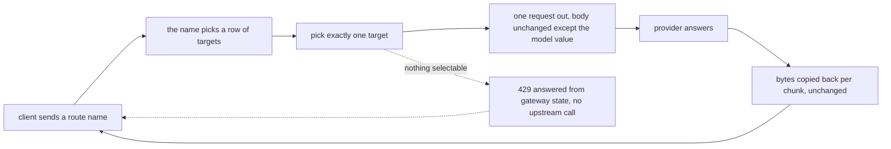

# PlainRoute

<!-- SPDX-License-Identifier: AGPL-3.0-only -->

> **A small, boring, transparent LLM gateway.**

PlainRoute is an OpenAI-compatible HTTP gateway in front of one or more targets. A
client sends a route name, the gateway picks one target, sends the body it received,
copies the response bytes back, and reports what happened. It does not rewrite the
response, does not retry on its own, and does not grow features that touch the
streaming path.

A target is one upstream entry: a model name, a base URL, one key read from the
environment, and its own endpoint path, headers and concurrency limit. Two targets
differ by any of them: "same model, different key" is one case, not the definition.

The targets behind one route name are balanced against each other. Different route
names are not balanced against each other, and one route reaches another only
through a configured fallback.

This project intentionally has a smaller scope and avoids modifying streaming responses
whenever possible.

PlainRoute is not affiliated with OpenAI, NVIDIA, LiteLLM, or any other company or
project. The OpenAI-compatible shape it serves is an interface it talks to, not an
endorsement or an affiliation.

## What it does

- One upstream attempt per client request. Never more.
- Load balancing across targets behind one route name: one selection per request,
  `least_active` by default or `round_robin`, and ties keep config order. There is
  no failover inside a single request, and no balancing between two route names.
- Per-target cooldown: for an error status the window is `routing.cooldown.status[<code>]`
  when the upstream did not send a `Retry-After`, and the value the upstream sent when it
  did, clamped by `routing.cooldown.max`. A status with no entry, or an entry of 0, does not
  cool a target down.
- Model name mapping: the model name comes from the target that was picked, and the
  `model` field in the request body is the only field PlainRoute changes. It changes by
  splicing bytes into the original document rather than re-serialising it.
  The response is never rewritten, so the model a client reads back is the one the
  upstream wrote, which is not necessarily the name the client sent.
- `/v1/models` reports route names, the distinct model names behind each, and the
  target count. The route name is the name a client sends in the `model` field; a model
  name in the listing says what is inside a route, it is not a name a client can send.
- Streaming responses are copied chunk by chunk and flushed per chunk, so the bytes the
  upstream produced arrive as the bytes the client receives.
- Structured logs, Prometheus metrics, health and readiness endpoints, SIGHUP reload,
  graceful shutdown.
- An optional api key gate for the API endpoints: off when nothing is configured, one
  constant-time comparison when it is.

## What it does not do

No guardrails, no prompt logging, no response enrichment, no cache, no queue, no
budget, no rate limiter of its own, no provider SDK zoo, no template rendering. Every one
of those would either change the bytes on the wire or turn one client request into more
than one upstream request. That is the line this project does not cross.

## Why it exists

Most gateways in this space are large because they add behaviour: they retry, they
transform, they summarise, they decide what a model should say. A gateway that does those
things cannot promise what the client asked for, and it cannot promise that one request
did not become five requests.

PlainRoute exists for the case where you want the boring thing: many accounts or
targets behind one route name, a key that got rate limited is taken out of the pool, the
response is what the provider sent. If a gateway answers a request the provider answered
successfully, that is a bug in this project.

## Quick start

The picture, then the smallest config, then one request. Nothing here needs a real key.



The smallest config that shows the point: one route name, two targets behind it. Save it as
`demo.yaml`.

```yaml
routes:
  demo:
    targets:
      - name: account-1
        model: provider/model-one
        base_url: http://127.0.0.1:8091/stream
        api_key_env: DEMO_KEY_1
      - name: account-2
        model: provider/model-two
        base_url: http://127.0.0.1:8091/stream
        api_key_env: DEMO_KEY_2
```

Run it against the fake upstream, which answers with fixed frames on fixed paths. The value of
`DEMO_KEY_1` is what selects the behaviour, because a key is what identifies a target:

```bash
# from the repository root
go run ./cmd/fakeupstream &                          # 127.0.0.1:8091, stats at /stats
DEMO_KEY_1=a1 DEMO_KEY_2=a2 go run ./cmd/plainroute -config demo.yaml
```

Send one request:

```bash
curl -s http://127.0.0.1:8080/v1/chat/completions \
  -H 'Content-Type: application/json' \
  -d '{"model":"demo","stream":true,"messages":[{"role":"user","content":"hi"}]}'
```

The client sent the route name `demo`, and what comes back is the three frames the upstream
produced, unchanged:

```text
data: {"object":"chat.completion.chunk","choices":[{"delta":{"role":"assistant"}}]}

data: {"object":"chat.completion.chunk","choices":[{"delta":{"content":"hi"}}]}

data: [DONE]
```

The log line for that request, from the same run, wrapped here for reading. `time` and
`request_id` are the ones that run produced:

```json
{"time":"2026-11-18T06:39:20.54505134Z","level":"INFO","msg":"request_completed",
 "request_id":"dff4c54d46336f0c","route":"demo","model":"provider/model-one",
 "target":"account-1","status":200,"stream":true,"ttft_ms":0,"duration_ms":0,
 "bytes":180,"active":1}
```

`route` is the name the client sent, `model` is the model of the target that answered,
`target` is which one was picked, and `bytes` is what was copied. The fake upstream counted
exactly one attempt for that key, which is the whole promise: one client request, one
upstream request.

```bash
curl -s http://127.0.0.1:8091/stats   # {"attempts":{"a1":1},"cancelled":null,"total":1}
```

Five things happened, and only two of them are decisions:

1. `demo` picked the row, which is the set of targets that can answer that name.
2. `least_active` picked one target. A tie keeps the order the config lists, so this run
   picked `account-1`. Sequential requests never overlap, so it keeps picking it.
3. The body went out once, with only the bytes of the `model` value replaced by the picked
   target's model. Nothing else in the document changed.
4. The answer was copied back per chunk and flushed per chunk. Nothing was parsed or
   re-formed, so the frames above are the frames the upstream wrote.
5. What was recorded is a routing fact: route, target, status, timings, byte count. There
   is no field in the logging package that could hold a key, a prompt or a response body.

A target that answered badly is taken out of the pool for the *next* request, not for this
one: this request ends with the answer it already got. When every target in the row is out
of the pool, the gateway answers from its own state instead of knocking, 429 with
`code: all_targets_cooling_down`.

## Install

```bash
go build -o bin/plainroute ./cmd/plainroute
cp config.example.yaml config.yaml
export EXAMPLE_API_KEY_1=...
export EXAMPLE_API_KEY_2=...
export LOCAL_KEY=...        # the example config has a second route named local
./bin/plainroute -config config.yaml
```

Every name the config uses has to be set, because `api_key_env` names an environment
variable. A config that references an unset one is a startup failure, not a request that
fails later, and the error names every missing variable at once.

Keys are read from the environment. Nothing that looks like a secret belongs in a config
file, and the gateway never writes a key into a log line. A key is resolved when the config
is read and held in memory after that. `api_key_env` is the name of a variable, never the
value, so a key written into a YAML field is not a shape this project accepts: a key in a
file is a key in git, in an image layer, and in a PR diff. A process sees the environment it
was started with, so a `SIGHUP` reload re-reads the same values, and changing a key means
starting a new process. In a container the environment is fixed when the container is
created, so a changed `.env` file needs a new container.

The config can reference the environment anywhere with `${NAME}` or `${NAME:-default}`, and
an unset reference without a default stops the process. For a key that does not help:
`api_key_env` is looked up as a name, so `${MISSING_KEY:-sk-example}` is read as a variable
called `sk-example`, which is not set, and the config is rejected. A key value can only come
from the environment.

Check that it is running:

```bash
curl -s http://127.0.0.1:8080/healthz            # ok
curl -s http://127.0.0.1:8080/v1/models
```

What the example config prints, from a real run:

```json
{
  "object": "list",
  "data": [
    {"id": "demo", "object": "model", "created": 1794982949, "owned_by": "plainroute",
     "models": ["provider/model-one"], "targets": 2},
    {"id": "local", "object": "model", "created": 1794982949, "owned_by": "plainroute",
     "models": ["qwen3:8b"], "targets": 1}
  ]
}
```

`created` is the process start time, the same number on every entry. `models` is what sits
inside the route; the sendable name is `id`.

## Route names and model names

```yaml
routes:
  demo:
    targets:
      - name: account-1
        model: provider/model-one
        base_url: https://api.example.com/v1
        api_key_env: EXAMPLE_API_KEY_1
        max_active: 4
      - name: account-2
        model: provider/model-one
        base_url: https://api.example.com/v1
        api_key_env: EXAMPLE_API_KEY_2
        max_active: 4
```

A client asks for `demo`, which is a route name. The gateway picks a target, sends
`provider/model-one` with that target's key, and the response comes back as the provider
produced it. The model name in the response is the one the provider wrote, not the one
the gateway chose.

Because the model belongs to the target, a route name can be the level a client codes
against while the config decides what answers it. A name such as `large`, `medium` or `small`
is the ordinary form of that: the client says the tier, the operator chose which real models
and providers sit behind it, and the balancing happens inside the name.

```yaml
routes:
  large:
    targets:
      - name: provider-a
        model: provider-a/big-model
        base_url: https://api.example.com/v1
        api_key_env: EXAMPLE_API_KEY_1
      - name: provider-b
        model: provider-b/huge-model
        base_url: https://api.other.example/v1
        api_key_env: EXAMPLE_API_KEY_2
```

Which model answers is the model of the target that was picked, and `/v1/models` reports the
route name together with the distinct model names behind it:

```json
{"id": "large", "models": ["provider-a/big-model", "provider-b/huge-model"], "targets": 2}
```

A name inside `models` is not a name a client can send. The listing reports what is inside a
route; the sendable name is `id`. Because of that, the `model` field in a response for a tier
name is not stable: one request may be answered by `provider-a/big-model` and the next by
`provider-b/huge-model`. A client that needs to know which model answered reads it from the
response, or from the log line for that request.

When the route name is the model name, the abstraction is transparent and `models` is left out
because it would only repeat the id:

```json
{"id": "qwen3:8b", "owned_by": "plainroute", "targets": 1}
```

A name that is not a configured route is a 404 with `code: model_not_found`. Lookup
accepts route names only: it used to accept the upstream model name as well, which was
possible only while one name mapped to exactly one model. A target carries its own model
now, so the same model can sit behind several routes, and any rule for choosing between
them would be unpredictable from the config.

## Multiple accounts example

Two keys for one model behind one route name, with a cooldown that keeps a limited key out
of the pool:

```yaml
routing:
  strategy: least_active          # ties keep the order they appear in the config
  cooldown:
    status:
      429: 10s
      401: 60s
      503: 15s
    max: 5m
    timeout: 30s                  # 0 disables cooling after a connection failure

routes:
  chat:
    targets:
      - name: work
        model: gpt-4o-mini
        base_url: https://api.openai.com/v1
        api_key_env: OPENAI_WORK_KEY
      - name: personal
        model: gpt-4o-mini
        base_url: https://api.openai.com/v1
        api_key_env: OPENAI_PERSONAL_KEY

retry:
  enabled: false
```

Account A returns 429. That request ends with the upstream error, exactly as the provider
answered it, and account A is cooled down. The *next independent request* chooses account
B. Nothing inside the first request tried account B. This is the whole design in one
paragraph, and there is a test and an end-to-end script that check it.

## Local OpenAI-compatible endpoint example

Anything that speaks the OpenAI shape works, including a local server:

```yaml
routes:
  local:
    targets:
      - name: ollama
        model: qwen3:8b
        base_url: http://127.0.0.1:11434/v1
        api_key_env: LOCAL_KEY    # any value; the key is still what identifies the target
```

## Api key gate (optional)

Off by default, and it is one key rather than a table of keys. `auth.api_key_env` names one
environment variable; when it resolves to a value, the api key a caller presents is compared
with it in constant time, so a wrong key does not reveal how many bytes matched.

```yaml
auth:
  api_key_env: PLAINROUTE_API_KEY
```

- Nothing configured means no gate, which is the documented default. A variable named in the
  config but not present in the environment is a startup failure, not a quietly open gate,
  because a half-configured gate reads as a working one.
- Give the variable a name this project owns: `PLAINROUTE_API_KEY`, not `API_KEY`. A generic name
  can be exported by another program in the same shell, or set by a shared `.env`, and then the
  process starts and compares a value nobody chose for it. A name collision is not a startup
  failure, so this is the one gate failure mode the config check cannot catch — the prefix is what
  tells this project's secret from another program's. The startup line prints the gate state and
  the name it read, never the value, so a collision is at least visible in the log.
- The key is read the ordinary way: `Authorization: Bearer <key>`, which is what any
  OpenAI-compatible client already sends. No separate header, no second naming scheme.
- The caller key and the target key are different things. The caller key decides who may
  use the gateway; the key that goes upstream is always the one the operator configured for
  the selected target, so a caller cannot aim a request at a key it was not given. The
  caller key is never forwarded, never logged, and never appears in a metric label.
- The gate covers the API endpoints (`/v1/*`). Health, readiness and the metrics page stay
  open, because a monitoring system that cannot authenticate is the ordinary case and those
  pages carry counts only.
- A rejection is the OpenAI error shape: 401, `code: invalid_api_key`,
  `type: authentication_error`. Rejections are counted in
  `plainroute_gateway_rejected_total{route="none",code="invalid_api_key"}`, the family of
  requests the gateway answered from its own state.
- One key is not accounts. Knowing which caller is which would need a table of keys, and a
  table of keys is the point this project stays out of.

## Routing and cooldown semantics

- A target is selectable when it is not cooling down and has not reached
  `max_active`.
- Selection is `least_active` by default, with `round_robin` as the other option. Ties
  keep config order, so the choice is reproducible rather than random.
- The two strategies answer different questions, and this was measured rather than assumed:
  12 sequential requests with four targets gave `round_robin` 3/3/3/3 and `least_active`
  12/0/0/0, because sequential traffic never overlaps and every request ties on "fewest in
  flight". If the limit you care about is per key, spread with `round_robin`; if it is per
  connection pool, `least_active` is the closer fit. Under real concurrency both converge.
- Cooldown for an error status is `routing.cooldown.status[<code>]` when the upstream sent
  no `Retry-After`. When it sent one, that value wins, and `routing.cooldown.max` clamps it so
  a hostile or broken value cannot make a target unavailable for an unreasonable time. The clamp
  applies to the value the upstream sent, not to the configured duration, which is used as
  written. An unparseable or non-positive `Retry-After` falls back to the configured duration.
- A status code with no entry, or an entry of 0, does not cool a target down: the target stays
  selectable, and the gateway sends no `Retry-After` because it applied no window. Nothing
  configured means the default map, which is `429: 10s`. That value is a prior for the silent
  case, not a measurement of any provider window, so it cannot be right for every provider. The
  choice is between holding a target out longer than the provider asked, and asking the same key
  again too soon: 10s sits between a per-second limiter and a per-minute limiter, which is the
  narrowest band a default can cover, and it is long enough that the same key is not asked again
  on every request. For a key that was told to slow down, the window is also the interval at
  which that key is asked again.
- A bigger cooldown value does not mean fewer upstream requests. One client request is one
  upstream attempt whenever a target is selectable, so a bigger window only moves answers from
  the provider to the gateway. Fewer requests come from the client backing off, or from setting
  the window you actually know instead of the prior. Measured with the default, on a
  single-target route at one request per second: 12 requests gave 2 upstream attempts, the other
  10 answered from gateway state, and the second attempt landed on the 10 second boundary.
- A connection, response-header or stream idle failure has no `Retry-After` to read, so it uses
  `routing.cooldown.timeout`. 0 disables it, and 0 is the default, which is why a connection
  failure is a failed request rather than a target taken out of the pool.
- When every target behind a route name is cooling, the gateway does not contact an
  upstream. It answers 429 with the OpenAI error shape and
  `code: all_targets_cooling_down`, and `Retry-After` is the recovery time of the target
  that recovers first.
- The `Retry-After` the gateway sends is the window it actually applied, not whatever the
  upstream printed.
- The gateway does not follow redirects. Upstream URLs come from config only, so a
  response body cannot point the proxy at a host that was not configured.
- Hop-by-hop headers are dropped in both directions. `Authorization` is always the key
  configured for the selected target, so a client cannot aim a request at a key it
  was not given.

## What a request carries through

The gateway reads two fields out of the body — `model` and `stream` — and forwards the
body as the bytes it received. Everything else is passed because it is passed as bytes, not
because it is understood. `temperature`, `max_tokens`, a tool choice, a field this project
does not know: whatever the client put in the body arrives, in the order the client wrote
it, with the numbers as the client wrote them. The only change is the bytes of the `model`
value.

What does not pass:

- The client's URL path is not used. The upstream URL is the target's base URL plus the
  target's `path`, default `/chat/completions`, so two targets can answer the same route at
  two different endpoints.
- The client's query string is not forwarded.
- The method is always POST.
- A compressed request body is not decompressed. A gzip body is rejected as `invalid_json`,
  because the gateway requires JSON text, and what it forwards is what it read.
- Hop-by-hop headers, `Content-Length` and `Host` on the request. `Content-Length` is set by
  the transport, because the forwarded body is not the length the client counted.
- On the response, the per-connection headers, and `Content-Length` is left to the transport
  so a stream that ended early is not described by a length that is wrong.

What is replaced rather than copied: `Authorization` becomes the key configured for the
selected target, per-target `headers` override what the client sent for the same name, and
`X-Request-Id` is the id the gateway generated — or the client's own value, when the client
sent one and it was 128 characters or shorter.

Checked against a real run, not against the reading of the code: a request with
`Cookie`, `X-Forwarded-For`, `Accept-Encoding: gzip`, `Connection: close` and an
`Authorization` header reached the upstream with the first two dropped by the deny list, the
caller key replaced, and the rest of the header set intact.

## Why retry is off by default

A gateway that retries changes the meaning of a request. One client request becomes two,
three, or ten upstream requests, and the party being rate limited is the one that told you
to slow down. Retrying also makes the numbers impossible to read: you cannot prove that
client requests and upstream attempts are the same, because they are not.

The client owns backoff, because the client is the one who knows whether a request is
worth repeating. `retry.enabled` exists for people who insist, and when it is on, a retry
only happens before any byte of the upstream response has reached the client. Once bytes
are on the wire, there is no taking them back.

There is a regression test for this: 50 client requests must never produce more than 50
upstream attempts, and the metrics must report the same numbers.

## Streaming transparency

- The response body is copied with no accumulation; the gateway never holds a model
  response in memory.
- The stream is flushed per read chunk, so frames reach the client in the order the
  upstream produced them.
- Frames are not re-formed. The opening role delta, tool call deltas as separate frames,
  and `[DONE]` all survive exactly.
- A stream that fails before the first byte is reported as an error, not as an empty
  successful response.
- A stream idle watchdog aborts a stream that has gone silent. The gateway does not invent
  a closing frame; the response ends with what it received.
- A client that goes away cancels the upstream request, and the two are told apart: an
  idle timeout is recorded as `stream_idle`, a client that left as `client_gone`.
- `timeouts.request` is 0 by default, so a long reasoning stream is not killed by an
  ordinary request timeout. Only the idle timeout applies.
- Compression is left to the client and the upstream. PlainRoute never decompresses, so
  the bytes it copies are the bytes the upstream sent.

## Metrics

`GET /metrics` (on by default):

| Metric | What it is |
| --- | --- |
| `plainroute_requests_total{route,target,status_class}` | Client requests handled |
| `plainroute_upstream_attempts_total{route,target,status_class}` | Upstream requests actually sent |
| `plainroute_active_requests{route,target}` | Requests in flight per target |
| `plainroute_target_in_cooldown{route,target}` | 1 while a target is cooling |
| `plainroute_cooldown_events_total{route,target,reason}` | Times a target was cooled down |
| `plainroute_request_duration_seconds{route,target,stream}` | End to end duration, per request |
| `plainroute_ttft_seconds{route,target}` | Time to the first upstream byte |
| `plainroute_stream_duration_seconds{route,target}` | Duration of a streamed response |
| `plainroute_bytes_streamed_total{route,target}` | Bytes copied to clients |
| `plainroute_upstream_errors_total{route,target,kind}` | Upstream failures by kind |
| `plainroute_client_disconnects_total{route,target}` | Clients that went away |
| `plainroute_stream_aborts_total{route,target,reason}` | Streams ended by the gateway |
| `plainroute_gateway_rejected_total{route,code}` | Requests the gateway answered from its own state |
| `plainroute_config_reloads_total{outcome}` | SIGHUP reloads, by outcome |
| `plainroute_in_flight_requests` | Requests being handled right now |
| `go_goroutines`, `go_memstats_heap_alloc_bytes`, `process_resident_memory_bytes` | The process itself |

The `route` label is the route a request resolved to, or `none` when the gateway answered
before any route was in play. It is never a value taken from client input: the name a client
sends in the `model` field is logged as `requested` rather than counted, because a label value
is never removed from the registry and a client can send any string.

The `kind` on `plainroute_upstream_errors_total` is one of `build_request`, `transport`,
`timeout`, `stream_idle`, `client_gone`. Two values a reader might expect are not among them:
a request that reached the upstream and came back with an error status is counted by
`upstream_attempts_total` with its status class, because the upstream did answer, and a
response cap is a reason on `plainroute_stream_aborts_total`, not an upstream failure. The log
carries `kind` on two events, `stream_ended_early` and `upstream_request_failed`, and there its
values are `transport`, `timeout`, `stream_idle`, `client_gone`.

`requests_total` and `upstream_attempts_total` are kept separately on purpose. With retry
disabled they should be the same number for proxied requests, and the difference is exactly
the requests the gateway answered itself. `cmd/bench` reads these numbers from the gateway
rather than counting them on the client, and fails if they disagree.

When the api key gate is on, its rejections are part of that difference: they are counted by
the gateway from its own state, with `route="none"` and `code="invalid_api_key"`, and no
upstream is contacted.

Logs carry routing facts only: request id, route name, the model the selected target
serves, target name, status, duration, time to first byte, bytes streamed, cooldown events,
disconnects, and the name a client sent when that name was not a configured route. There is no field in the logging package that could hold a key, a prompt or a
response body, so a log line cannot leak one by accident.

## Docker

```bash
docker build -t plainroute .
docker run --rm -p 127.0.0.1:8080:8080 \
  --env-file .env \
  -v $PWD/config.yaml:/etc/plainroute/config.yaml:ro \
  plainroute
```

Pass the variables by the names the config uses. `api_key_env` names an environment
variable, and the gateway looks that name up in the environment, so every name the
config uses has to be set — in the example config that is `EXAMPLE_API_KEY_1`,
`EXAMPLE_API_KEY_2` and `LOCAL_KEY`. A container missing one of them does not start,
and the error names every missing variable at once, so a missing key is a startup
failure rather than a request that fails later.

The image is 28 MB, runs as a named non-root user, and has no write access anywhere. The
health check is the live endpoint. Readiness is not checked inside the image, because a
target that is cooling down is still a healthy container.

The compose file is the shape this project runs in production: loopback-only mapping,
read-only root filesystem, all capabilities dropped, `no-new-privileges`, a pid and memory
limit, a 30 second stop grace, and keys from a `.env` file with 600 permissions. Verified by
starting it for real: `health=healthy user=plainroute readonly=true caps=[ALL]`.

Inside a container, `127.0.0.1` is the container itself. If the upstream runs on the host,
write `host.docker.internal` in the config file (the compose file maps that name to the
gateway), not `127.0.0.1`.

The name a published image would carry is `ghcr.io/40960/plainroute`. Nothing is published
from this repository automatically; the CI job builds the image without pushing it.

## Security

- Keys come from environment variables and are never written into a config file, a log
  line, or an image layer.
- The gateway never logs a key, the `Authorization` header, prompt content, or response
  content.
- Upstream URLs come only from configuration; the gateway does not follow redirects, so a
  response cannot redirect the proxy to an arbitrary host with the request body.
- `base_url` is checked at load: no credentials, no query, http or https only.
- Request bodies and response bodies have configured size limits, checked before anything
  is forwarded.
- The metrics page reports counts, gauges and histograms. It contains no key names and no
  prompt content. If the page must not be public, put it behind your own restriction or set
  `metrics.enabled: false`.
- Authentication is optional and off by default. When `auth.api_key_env` resolves to a value,
  the api key a caller presents is compared in constant time, on the API endpoints only. With
  nothing configured there is no gate, and then any process that can reach the listening port
  can use the configured targets — which is why the compose file maps the port on
  loopback only.
- The caller api key is never forwarded upstream, never logged, and never appears in a metric
  label. The key the provider sees is always the target key.
- There is no authorisation, no accounts and no multi-tenancy. One optional key decides who
  may call; it does not say who is calling. If you need that, it belongs in front of the
  gateway.
- See [SECURITY.md](SECURITY.md) for how to report a problem.

## Limitations

Known and deliberate. These are not bugs to be fixed by adding complexity:

- No queue, no backpressure beyond `max_active`, no per-model concurrency limit.
- No circuit breaker beyond the cooldown map.
- No provider-specific error normalisation: an upstream error body is forwarded as it
  arrived, which means different providers produce different error bodies.
- No retry, so a transient failure is a failed request. That is the point.
- No cache, no accounting, no budgets, no billing.
- No OpenTelemetry traces. Metrics and logs only.
- No accounts, no multi-tenancy, no per-key quotas. The api key gate is one optional key, not
  a table of keys, so it cannot say which caller is which.
- Model fallback is opt-in, bounded, and only possible before the first byte reaches the
  client.
- A response cap can stop copying mid-frame. The client keeps what arrived; the gateway
  does not close a frame it did not receive.
- Single process, single binary, no clustering. State is per process: two gateway
  processes do not share cooldowns.

## Troubleshooting

**Every request gets 429 from the gateway with `all_targets_cooling_down`.** The
gateway is answering from its own state, not from a provider. Look at `Retry-After`: it is
the recovery time of the target that recovers first. If the window is longer than you
expected, the upstream sent a big `Retry-After`, and `routing.cooldown.max` clamped it.

**A request gets 404 with `model_not_found`.** The value in the `model` field is read as a
route name, not as a model name, so the exact model name a target carries is not a name a
client can send. `/v1/models` lists the route names and the model names behind each one.

**A stream ends without `[DONE]`.** The upstream stopped sending. The gateway does not
invent a closing frame. Check `plainroute_stream_aborts_total` and the log line with
`kind=stream_idle`.

**A stream is cut off earlier than expected.** `server.max_response_bytes` stopped copying.
The client keeps the bytes that arrived; the gateway counted the limit in
`plainroute_stream_aborts_total` with `response_limit`.

**A request fails with 502 or 504 while the provider looks healthy.** The gateway does not
retry. A connection failure or an idle timeout is reported as it happened. Check the log
line for `kind` (`transport`, `timeout`, `stream_idle`, `client_gone`).

**The gateway returns 500.** That should not happen for a request the upstream answered. If
it does, it is a bug in this project, and it should be reported with the request id.

**Keys are missing at startup.** The config reports every problem at once, naming the
environment variable. A config that references an unset variable is a startup failure, not
a runtime surprise. The same is true for the gate: an `auth.api_key_env` that names an unset
variable stops the process rather than leaving a gate that looks on but checks nothing.

**Every request gets 401 with `invalid_api_key`.** The gate is on, because
`auth.api_key_env` resolved to a value. The client has to present that key as
`Authorization: Bearer <key>`, the ordinary form. A gateway that is running either has no
gate or a working one, so this is a client-side mismatch, not a half-configured gate. The
key a caller presents is not the key the provider sees, so if the provider works when you
send the caller key directly, you are reading the wrong variable. If a key that is not yours is
accepted instead, the name is the problem: a generic name such as `API_KEY` reads whatever
another program exported, so the gate is holding that program's value.

**Reload did nothing.** A failed `SIGHUP` reload keeps the running config instead of
breaking a working gateway. The failure is logged and counted in
`plainroute_config_reloads_total{outcome="failed"}`. Target state, including cooldowns,
survives a successful reload.

## License

AGPL-3.0-only. See [LICENSE](LICENSE). Every file in the repository carries `SPDX-
License-Identifier: AGPL-3.0-only` in its header, apart from `LICENSE` itself and
`go.sum`, which cannot carry a comment. `./scripts/check-headers.sh` checks it, and
`make headers` runs the same check locally.

Modifications and distribution must follow AGPL-3.0. If you modify the program and serve
it to users over a network, the AGPL-3.0 network-interaction clause (section 13) may
require providing the corresponding source code to those users. This is a statement about
the licence text, not legal advice.

## Development

```bash
make fmt vet test race build headers
./scripts/e2e.sh          # seven end-to-end cases against two real processes
make bench                # load test, checked against the gateway's own counters
python3 scripts/generate-config.py --keys 4 --out config.yaml   # model list from the live endpoint, snapshot fallback
```

See [CONTRIBUTING.md](CONTRIBUTING.md), [docs/architecture.md](docs/architecture.md), and
[CHANGELOG.md](CHANGELOG.md).
